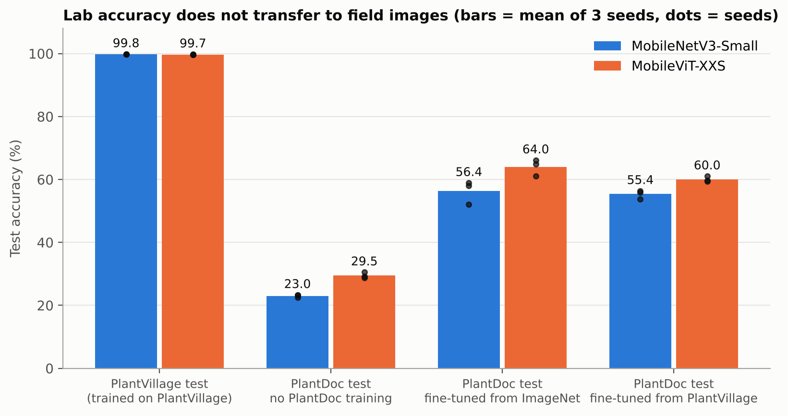
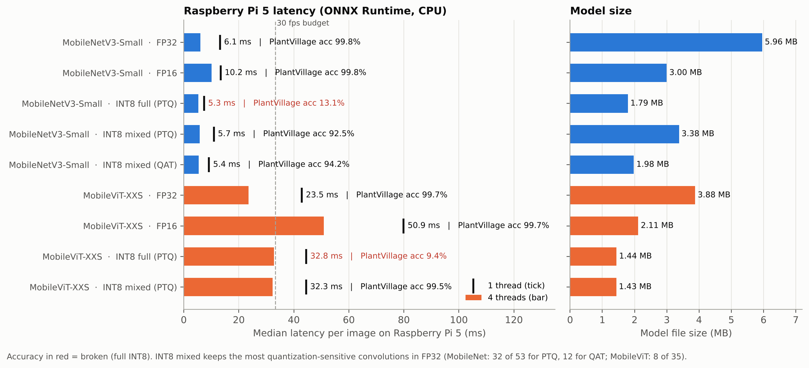

# Lightweight CNN vs. Transformer for Plant Disease Classification

DS 504/704 Data Mining and Decision Support, course project.

We compare a lightweight CNN (**MobileNetV3-Small**) and a lightweight hybrid CNN–transformer (**MobileViT-XXS**) for plant disease classification, with the goal of a model that is usable on small devices. Both models are tuned under an identical protocol on **PlantVillage** (lab images, 38 classes), tested on real-world images from **PlantDoc** (28 classes), compressed (FP16, INT8) and benchmarked on a **Raspberry Pi 5**.

Our starting point is Bahaa et al. (2026), who compared the same two architectures on PlantVillage with hand-chosen settings and two different frameworks. We reproduce their setup in a single framework, add Bayesian hyperparameter optimisation with an equal budget per model, and report every result as mean ± std over three seeds.

## Key results

| | MobileNetV3-Small | MobileViT-XXS |
|---|---|---|
| Parameters | 1.56 M | 0.96 M |
| PlantVillage test accuracy (5,431 images) | **99.80 ± 0.03 %** | 99.71 ± 0.06 % |
| PlantDoc test, trained on PlantVillage only | 23.0 ± 0.5 % | **29.5 ± 0.9 %** |
| PlantDoc test, fine-tuned on PlantDoc (from ImageNet) | 56.4 ± 3.7 % | **64.0 ± 2.7 %** |
| FP16: size / PlantVillage accuracy | 3.00 MB / 99.80 % | 2.11 MB / 99.71 % |
| Best INT8: size / PlantVillage accuracy | 1.98 MB / 94.3 ± 0.7 % (QAT, 12 convs in FP32) | **1.43 MB / 99.53 ± 0.09 %** (8 convs in FP32) |
| Raspberry Pi 5 latency, FP32, 4 threads (1 thread) | **6.1 ms** (13.2 ms) | 23.5 ms (42.9 ms) |

1. **Lab accuracy does not transfer to the field.** Both models reach ~99.8 % on PlantVillage but only 23–30 % on PlantDoc's field images, and identify the right crop only ~30 % of the time.
2. **On field images MobileViT is consistently better** (+6 points without PlantDoc training, +5–8 points after fine-tuning; every MobileViT seed beats every MobileNet seed). On PlantVillage the models are practically equivalent (MobileNet ahead by ~5 of 5,431 images; McNemar p = 0.017 indicative, Welch p = 0.07 across seeds).
3. **Fine-tuning on ~2,100 field images matters more than the architecture** (23–30 % → 55–64 %). Starting from our PlantVillage models did not help compared with ImageNet weights.
4. **Standard INT8 quantization breaks both models** (~10 % accuracy). Layer-by-layer analysis traced this to activation outlier channels (25–100× range differences) entering early depthwise and stem convolutions. Keeping the 8 most sensitive convolutions in FP32 makes MobileViT INT8 nearly lossless (99.53 %, 2.7× smaller than FP32); MobileNet stays unstable even with 32 of 53 convolutions in FP32. Our simplified QAT degraded FP32 accuracy and is not a working fix.
5. **On the Raspberry Pi 5 MobileNet is ~4× faster** (6.1 vs 23.5 ms per image). Compression did not speed things up on the Pi's CPU: FP16 is slower than FP32 (no optimised FP16 kernels), and INT8 gives MobileNet only a small gain while making MobileViT slower (32.3 ms), because of the conversions around layers that stay in float. All FP32 models run well within a 30 fps budget.
6. **The two hyperparameter optimisation results:** tuning raised validation macro-F1 by 11–14 points over the paper's configurations in short runs; the transformer depended much more on the learning-rate schedule (cosine with warmup).

**Deployment choice:** MobileViT-XXS (FP32, or INT8-mixed when storage matters) for accuracy on real-world images; MobileNetV3-Small (FP32) when latency or energy dominate.

| | |
|---|---|
|  |  |
|  |  |

More figures: [HPO learning curves](figures/2_hpo_learning_curves.png), [hyperparameter importance](figures/3_hpo_param_importance.png), [LR vs. score](figures/4_hpo_lr_vs_score.png), [test confusions](figures/6_confusion_confusable_classes.png), [PlantDoc per-class recall](figures/8_plantdoc_per_class_recall.png).

## Method in brief

Full details, including every deviation from the paper, are in [docs/methodology.md](docs/methodology.md).

- **Data:** PlantVillage, colour images (54,305 images, 38 classes), fixed stratified 70/20/10 split ([data/splits.csv](data/splits.csv)). PlantDoc cropped-leaf images (2,578, 28 classes, all mapped one-to-one onto PlantVillage classes), original train/test split.
- **Training (from the paper):** 224×224 input, flips, ±10° rotation, brightness 0.5–1.5, ImageNet-pretrained weights, cross-entropy, up to 20 epochs. **Our changes:** PyTorch + timm for both models, AdamW, mixed precision, per-model input normalisation.
- **HPO:** Optuna TPE (Bayesian optimisation) with median pruning, 20 trials per model, 5 epochs on a 30 % training subset, validation macro-F1 objective; top-3 configurations retrained on full data before choosing the winner.
- **Final training:** 3 seeds × 20 epochs, checkpoint with the lowest validation loss, one test evaluation.
- **Compression:** ONNX export; FP16; INT8 static (QDQ, per-channel weights, MinMax calibration) and dynamic; mixed precision chosen on a validation subset; quantization-aware fine-tuning (3 epochs).
- **PlantDoc:** cross-domain test of all checkpoints; fine-tuning on PlantDoc train from ImageNet vs. from our PlantVillage models (3 seeds each).
- **Raspberry Pi 5:** ONNX Runtime on CPU, median and 95th-percentile latency over 200 single-image runs with 1 and 4 threads, accuracy check on 380 test images, temperature and throttling monitored.

## Repository structure

```
data/splits.csv          fixed PlantVillage train/val/test split + HPO subset flag
notebooks/               Kaggle notebooks for each phase (see notebooks/README.md)
src/                     split creation, summaries, figure scripts, Raspberry Pi benchmark
results/hpo/             Optuna studies (.db) and all trials (.csv)
results/top3_check/      full-data retraining of the HPO top-3
results/final/           final PlantVillage runs: histories, metrics, per-class F1, test predictions
results/quantization/    PTQ, INT8 diagnosis, QAT and mixed-precision results
results/plantdoc/        cross-domain and fine-tuning results
results/pi/              Raspberry Pi 5 benchmark
results/summary.csv, results/deployment_summary.csv
figures/                 all report figures
logs/                    raw HPO logs
docs/methodology.md      detailed methodology, decisions and limitations
```

Model checkpoints (`.pt`, `.onnx`) are kept as Kaggle notebook outputs, not in the repository.

## Reproducing

Training and evaluation ran on Kaggle (2× Tesla T4). Attach [`abdallahalidev/plantvillage-dataset`](https://www.kaggle.com/datasets/abdallahalidev/plantvillage-dataset) and the split file, then run the notebooks in the order listed in [notebooks/README.md](notebooks/README.md). PlantDoc is cloned from [GitHub](https://github.com/pratikkayal/PlantDoc-Dataset) inside the PlantDoc notebook. The Pi benchmark is `src/pi_benchmark.py`.

Tables and figures can be regenerated locally from `results/`:

```bash
pip install -r requirements.txt
python src/summarize.py          # results/summary.csv + statistical comparison
python src/plot_hpo.py           # figures 1-4
python src/plot_final.py         # figures 5-6
python src/plot_plantdoc.py      # figures 7-8
python src/deployment_table.py   # results/deployment_summary.csv + figure 9
```

## References

- Bahaa et al., "A Smart AIoT-Based Mobile Application for Plant Disease Detection and Environment Management in Small-Scale Farms Using MobileViT," *AgriEngineering* 8(1), 11, 2026. https://doi.org/10.3390/agriengineering8010011
- Singh et al., "PlantDoc: A Dataset for Visual Plant Disease Detection," CoDS-COMAD 2020. https://arxiv.org/abs/1911.10317
- Nagel et al., "Data-Free Quantization Through Weight Equalization and Bias Correction," ICCV 2019.

## Team

<!-- Add team members and contributions (e.g. CRediT roles) -->
