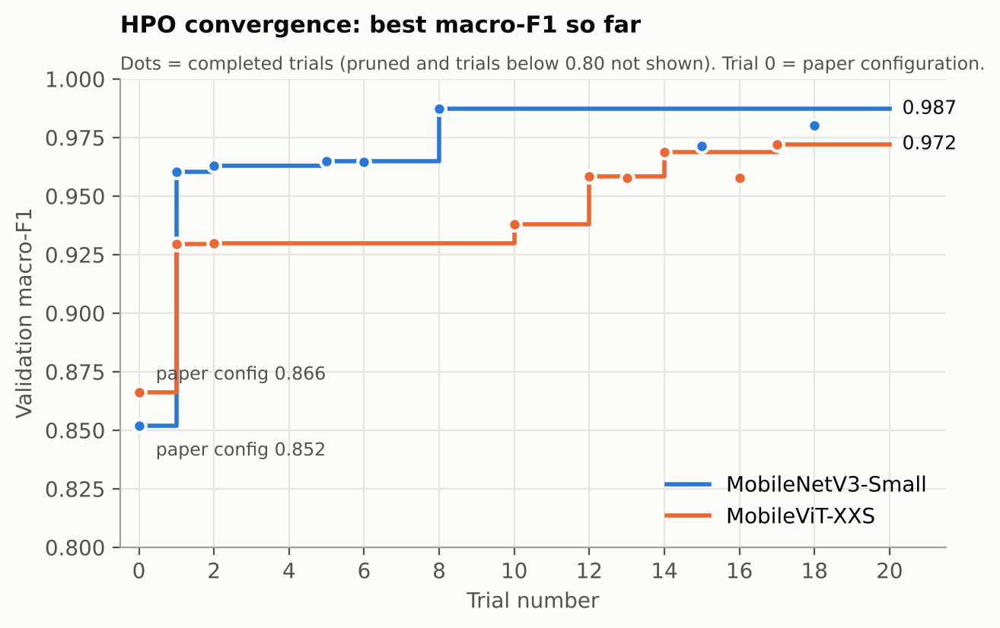
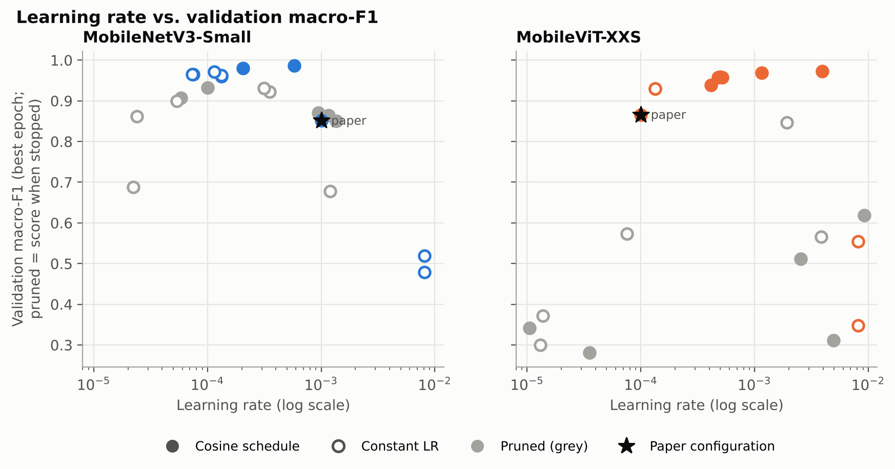
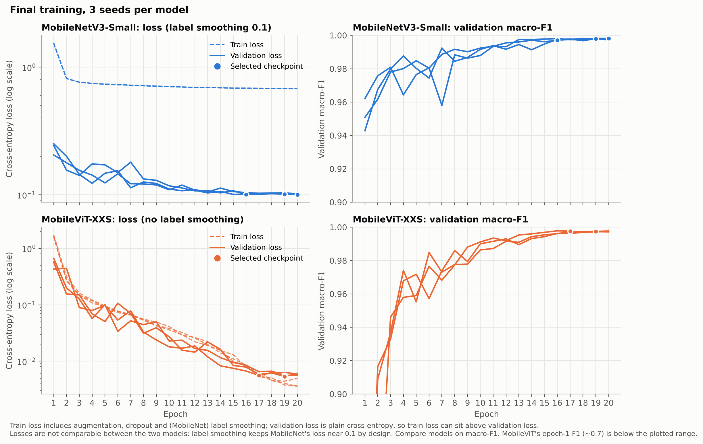
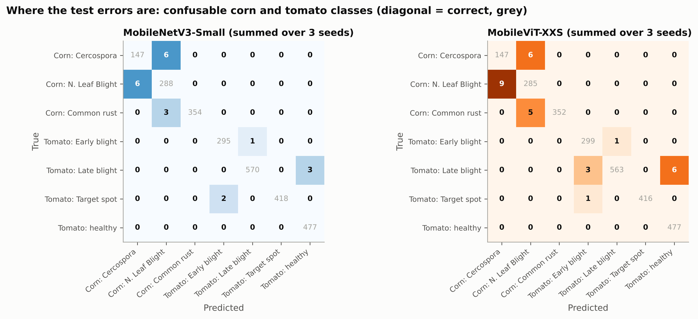

# Lightweight CNN vs. Transformer for Plant Disease Classification

DS 504/704 Data Mining and Decision Support, course project.

We compare a lightweight CNN (**MobileNetV3-Small**) and a lightweight hybrid CNN–transformer (**MobileViT-XXS**) for 38-class plant disease classification on **PlantVillage**. The goal is not the highest accuracy but a model that is usable on small devices, so both models are tuned under an identical protocol and later evaluated for deployment (quantization, CPU latency).

Our starting point is Bahaa et al. (2026), who compared the same two architectures on PlantVillage with hand-chosen settings and two different frameworks. We reproduce their setup in a single framework, add Bayesian hyperparameter optimisation with an equal budget per model, and report every result as mean ± std over three seeds.

## Key results (test set, 5,431 images, 3 seeds)

| Model | Params | Test accuracy | Test macro-F1 | Test errors per seed |
|---|---|---|---|---|
| MobileNetV3-Small | 1.56 M | **99.80 ± 0.03 %** | **0.9967 ± 0.0003** | 11, 9, 12 |
| MobileViT-XXS | 0.96 M | 99.71 ± 0.06 % | 0.9958 ± 0.0006 | 19, 16, 13 |

1. **Tuning matters more than architecture here.** Hyperparameter optimisation raised validation macro-F1 by 11–14 points over the paper's configurations in the short HPO runs. After tuning, both models exceed the paper's reported accuracy, and the ~2-point MobileViT advantage reported in the paper disappears.
2. **The two models are practically equivalent on PlantVillage.** MobileNet is ahead in all three seed pairs (28 vs. 12 discordant test images, McNemar p = 0.017, indicative only because the same images are reused across seeds), but the gap is ~5 images out of 5,431 and not significant across seeds (Welch p = 0.07, n = 3). Deployment metrics, not PlantVillage accuracy, should decide between them.
3. **The transformer is more sensitive to the learning-rate schedule.** All of MobileViT's top-5 HPO trials used cosine decay with warmup; high constant learning rates made it diverge. MobileNet's top trials mixed constant and cosine schedules.
4. **Short HPO runs are biased toward fast starters.** For MobileViT, the HPO winner (highest learning rate) ranked last when the top-3 configurations were retrained on full data. For MobileNet, the ranking held within noise.
5. **Both models fail on the same, visually similar classes**, mainly corn Northern Leaf Blight ↔ Cercospora (Gray) leaf spot (15 of the errors over three seeds for each model).

| | |
|---|---|
|  |  |
|  |  |

More figures: [HPO learning curves](figures/2_hpo_learning_curves.png), [hyperparameter importance](figures/3_hpo_param_importance.png).

## Method in brief

Full details, including every deviation from the paper, are in [docs/methodology.md](docs/methodology.md).

- **Data:** PlantVillage, colour images (54,305 images, 38 classes); fixed stratified 70/20/10 split ([data/splits.csv](data/splits.csv)), same ratios as the paper.
- **Training setup (from the paper):** 224×224 input, horizontal/vertical flips, ±10° rotation, brightness 0.5–1.5, ImageNet-pretrained weights, cross-entropy loss, up to 20 epochs.
- **Our changes:** PyTorch + timm for both models; AdamW; mixed precision; each model normalised with its own pretraining statistics.
- **Phase 1, HPO:** Optuna TPE (Bayesian optimisation) with median pruning, 20 trials per model, 5 epochs on a stratified 30 % training subset, objective = validation macro-F1. Trial 0 was the paper's configuration. Search space: learning rate, weight decay, batch size, head dropout, label smoothing, LR schedule.
- **Top-3 check:** the 3 best configurations retrained on the full training set for 10 epochs; winner chosen by validation macro-F1 (test set untouched).
- **Phase 2, final training:** winner trained with 3 seeds for 20 epochs; checkpoint with the lowest validation loss evaluated once on the test set.

## Repository structure

```
data/splits.csv        fixed train/val/test split + HPO subset flag (paths relative to the Kaggle dataset)
notebooks/             Kaggle notebooks for each phase (see notebooks/README.md)
src/                   scripts: split creation, results summary, figure generation
results/hpo/           Optuna studies (.db) and all trials (.csv)
results/top3_check/    full-data retraining of the HPO top-3, per model
results/final/         final runs: per-epoch history, val/test metrics, per-class F1, test predictions (.npz)
results/summary.csv    one row per final run (generated by src/summarize.py)
figures/               all report figures (generated by src/plot_hpo.py and src/plot_final.py)
logs/                  raw HPO logs
docs/methodology.md    detailed methodology, decisions and limitations
```

Model checkpoints (`.pt`) are not stored in the repository; they are kept as outputs of the Kaggle notebooks.

## Reproducing

Training ran on Kaggle (2× Tesla T4). Attach the dataset [`abdallahalidev/plantvillage-dataset`](https://www.kaggle.com/datasets/abdallahalidev/plantvillage-dataset) to every notebook, and run them in order:

1. `src/prepare_splits.py`: creates `splits.csv` (or use the copy in `data/`).
2. HPO notebooks: one per model; outputs the Optuna study and the top-3 configurations.
3. Phase 2 notebooks: top-3 check + 3-seed final training; needs the HPO notebook output as an input.

Results and figures can be regenerated locally from the files in `results/`:

```bash
pip install -r requirements.txt
python src/summarize.py     # results/summary.csv + statistical comparison
python src/plot_hpo.py      # figures 1-4
python src/plot_final.py    # figures 5-6
```

## Status

- [x] Data split, HPO, top-3 check, final training (3 seeds per model)
- [ ] Quantization (FP32 vs. FP16 vs. INT8): accuracy, model size, CPU latency
- [ ] Cross-domain evaluation on field images (PlantDoc)
- [ ] Exploratory data analysis and error analysis (Grad-CAM)

## Reference

Bahaa et al., "A Smart AIoT-Based Mobile Application for Plant Disease Detection and Environment Management in Small-Scale Farms Using MobileViT," *AgriEngineering*, vol. 8, no. 1, p. 11, 2026. https://doi.org/10.3390/agriengineering8010011

## Team

<!-- Add team members and contributions (e.g. CRediT roles) -->
